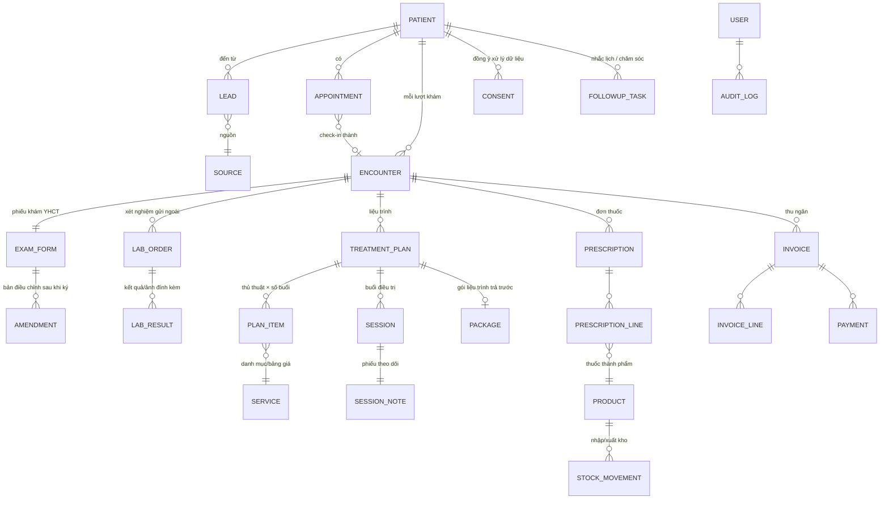

# Đề xuất thiết kế EMR Phòng khám YHCT (bản để duyệt)

> Đây là bước 1 theo yêu cầu: **chưa viết code**. Anh/chị xem, sửa, rồi duyệt thì tôi mới bắt đầu xây.


## ✅ CẬP NHẬT v2 – sau khi nhận mẫu phiếu, bảng giá và câu trả lời (19/11/2026)

**Đã chốt:** Cloudflare Tunnel · sao lưu Google Drive · nhắc lịch gửi tay (mẫu tin) · in A4/A5 · "hóa đơn" = phiếu thu nội bộ · chỉ thuốc thành phẩm · **33 tài khoản** (3 quản lý, 5 lễ tân, 5 bác sĩ, 20 trị liệu viên; + sale).

**Điều chỉnh thiết kế vì mẫu thật khác giả định ban đầu:**
1. Đây là phòng khám **YHCT – Phục hồi chức năng**, phiếu khám thiên về cơ xương khớp (tư thế, biên độ vận động, chuỗi mạc, nhiệm pháp thần kinh…) cộng phần Tứ chẩn. Phiếu khám lưu **có cấu trúc theo từng mục I–XIII** (tick-box + ô tự do), không chỉ là văn bản.
2. **Mục V "Sàng lọc an toàn"** là điểm an toàn bệnh nhân quan trọng: kết luận *Tiếp nhận / THẬN TRỌNG / HOÃN-CHUYỂN TUYẾN* sẽ hiện **cảnh báo nổi bật** cho trị liệu viên khi mở buổi điều trị (kèm chống chỉ định đã tick: máy tạo nhịp, có thai, rối loạn đông máu…).
3. **Liệu trình** (mục X): số buổi, tần suất, **tái lượng giá sau N buổi** → hệ thống nhắc bác sĩ khi đến buổi tái lượng giá.
4. **Phiếu theo dõi**: mỗi buổi gồm ngày, diễn tiến, **nhiều dòng phương pháp** (mã PP – thời gian – thông số/vùng), người thực hiện, ghi chú. Mã PP: CC, ĐX, SA, XK, TT, HN, TLMM, DĐK/NC, DC. Mỗi thiết bị có gợi ý ô thông số (ĐX: chế độ–tần số–cường độ; SA: MHz–W/cm²–chế độ; XK: tần số–áp lực–số xung; TT: cường độ–tần số; HN: khoảng cách). In ra theo khổ 10 buổi/tờ như mẫu.
5. **Danh mục dịch vụ** theo menu: 3 **combo** (Cơ bản 500k/45′, Tiêu chuẩn 800k/60–75′, Chuyên sâu 1.300k/100′) và 10 **dịch vụ lẻ** (150k–400k). Combo là một gói gồm các bước thủ thuật; ghi nhận được cả "combo" lẫn "từng kỹ thuật đã làm" để thống kê.
6. Bác sĩ chỉ kê **thuốc thành phẩm** (mục XIII: tên thuốc + liều/cách dùng).

**Các giả định tôi đang dùng (anh/chị sửa nếu sai):**
- Kho thuốc: **tồn kho theo số lượng + giá nhập + hạn dùng (không bắt buộc)** – chưa quản lý lô chặt chẽ.
- Giảm giá: cho phép **giảm giá theo dòng/hóa đơn kèm lý do** (chỉ quản lý duyệt). Hoàn tiền và chuyển nhượng buổi: để giai đoạn sau.
- Cảnh báo lỗi: **Email** (qua healthchecks.io) và **webhook**; Zalo cần Zalo OA nên làm sau.

**Điểm cần anh/chị làm rõ về mẫu:**
- ~~Mục XII bị thiếu~~ → đã chốt: là mục thiếu trong mẫu, hệ thống đánh số lại liên tục I–XII (XII = Điều trị thuốc).
- Phiếu khám có "Hơ ngải, Điện châm" nhưng **menu không có** (menu có Máy nén ép, Parafin nhưng phiếu khám không có); phiếu theo dõi có mã **DC (Diện chẩn)** nhưng menu cũng không có. Cần thống nhất 1 danh mục thủ thuật + giá.
- Giá combo là **giá mỗi buổi** hay giá cả liệu trình? Có bán **gói nhiều buổi** trả trước không?
- Tên miền: Cloudflare Tunnel cần 1 tên miền (vd `khoiphucviet.vn`) đã quản lý trên Cloudflare. Phòng khám có tên miền chưa?
- Giấy phép hoạt động, địa chỉ, SĐT, hotline in trên phiếu.

## Trạng thái xây dựng

| Giai đoạn | Trạng thái |
|---|---|
| 0 – Khung, Docker, đăng nhập + 2FA, phân quyền, nhật ký | ✅ xong, đã kiểm thử |
| 1 – Lead, lịch hẹn, tiếp đón, hàng đợi | ✅ bản đầu (còn thiếu: sửa/ghép hồ sơ, lịch theo bác sĩ dạng lưới) |
| Hạ tầng – Docker Compose, sao lưu mã hóa → Google Drive, khôi phục | ✅ sao lưu/khôi phục đã thử trên máy dev; **chưa chạy thử Docker thật & Google Drive** (môi trường này không có Docker) |
| 2 – Phiếu khám YHCT-PHCN (mục I–XII, tự lưu nháp, ký/khóa, điều chỉnh có lý do, in A4) | ✅ xong, đã kiểm thử (còn: in gọn về 2 trang, đơn thuốc in riêng) |
| 3 – Liệu trình + Phiếu theo dõi (chỉ định điền sẵn từ phiếu khám, ghi buổi trên điện thoại, đếm buổi, tái lượng giá, in 10 buổi/tờ A4) | ✅ xong, đã kiểm thử |
| 4 – Thu ngân (phiếu thu nội bộ), gói trả trước, thuốc thành phẩm, đơn thuốc, tồn kho | ✅ xong, đã kiểm thử (dùng dữ liệu MẪU cho thuốc và gói – chờ danh mục thật) |
| 5 – Nhắc lịch & chăm sóc sau điều trị (danh sách tự động, mẫu tin Zalo/gọi, ghi kết quả) | ✅ xong, đã kiểm thử (nội dung lưu ý chăm sóc cần bác sĩ duyệt) |
| 6 – Báo cáo (doanh thu ròng, dịch vụ, nguồn khách, sale, KTV, bác sĩ, quay lại, công nợ, xuất CSV) | ✅ xong, đã kiểm thử |
| 7 – Triển khai thật trên mini PC, tập huấn, thẩm định pháp lý | ⏭ cần làm cùng người kỹ thuật tại phòng khám (xem `cai-dat.md`, `doi-chieu-phap-ly.md`) |

---

## 1. Kiến trúc tổng thể (giải thích dễ hiểu)

```
 Điện thoại / Laptop / Máy bàn (trình duyệt)
            │  (qua Tailscale hoặc Cloudflare Tunnel – KHÔNG mở cổng Internet)
            ▼
 ┌─────────── Mini PC tại phòng khám (Docker) ───────────┐
 │  Caddy (HTTPS)  →  Web (Next.js)  →  API (NestJS)     │
 │                                         │             │
 │                                    PostgreSQL         │
 │                                    Thư mục file (ảnh KQ xét nghiệm) │
 │  Dịch vụ sao lưu: mỗi đêm → nén → mã hóa → đẩy cloud  │
 │  Dịch vụ giám sát: lỗi sao lưu / mất kết nối → báo Zalo/Email │
 └───────────────────────────────────────────────────────┘
                    │ (mã hóa, chỉ gửi ra)
                    ▼
        Cloud lưu bản sao lưu (Backblaze B2 / Google Drive / S3)
```

**Đề xuất chọn:**
- Truy cập từ xa: **Tailscale** cho nhân viên (đơn giản nhất, miễn phí tới 3 người dùng, trả phí ~6$/người/tháng với team lớn hơn) hoặc **Cloudflare Tunnel** (nhân viên chỉ cần mở một địa chỉ web, không cài app). Với 15 người dùng cả điện thoại, tôi **nghiêng về Cloudflare Tunnel + Cloudflare Access** (đăng nhập email) vì nhân viên không phải cài gì. → *Cần anh/chị chọn.*
- Sao lưu: `pg_dump` hằng đêm + `restic`/`rclone` mã hóa đẩy lên **Backblaze B2** (rẻ, ~vài chục nghìn đồng/tháng). Có sách hướng dẫn khôi phục từng bước và **bài kiểm tra khôi phục** mỗi tháng.
- Mini PC: khuyến nghị ≥ 16GB RAM, SSD 512GB, kèm **UPS** (bộ lưu điện) – tránh hỏng DB khi mất điện.
- Cảnh báo: gửi qua **Zalo OA/Telegram/Email** (anh/chị chọn) khi sao lưu thất bại hoặc máy chủ mất kết nối (dùng dịch vụ giám sát bên ngoài kiểu Uptime Kuma/Healthchecks.io để biết cả khi *mini PC tắt hẳn*).

## 2. Vai trò & quyền

| Chức năng | Sale | Lễ tân | Bác sĩ | Y sĩ/TLV | Quản lý |
|---|:-:|:-:|:-:|:-:|:-:|
| Lead, lịch hẹn | ✅ | xem/sửa | xem lịch mình | xem lịch mình | ✅ |
| Thông tin hành chính BN | tên/SĐT | ✅ | xem | xem tối thiểu | ✅ |
| Nội dung bệnh án | ❌ | ❌ (chỉ in) | ✅ | chỉ định được giao | ✅ xem |
| Phiếu theo dõi điều trị | ❌ | xem tiến độ buổi | ✅ | ✅ ghi | ✅ |
| Thu ngân, bán thuốc | ❌ | ✅ | kê đơn | ❌ | ✅ |
| Báo cáo / danh mục / nhân sự | ❌ | ❌ | ❌ | ❌ | ✅ |

Bảo mật: đăng nhập 2 lớp (TOTP – app Google Authenticator; bắt buộc với bác sĩ/quản lý), nhật ký truy cập (ai xem hồ sơ nào, lúc nào), tự đăng xuất khi không dùng, mã hóa đĩa mini PC (LUKS) + mã hóa sao lưu + HTTPS.

## 3. Sơ đồ dữ liệu (rút gọn)



**Các điểm thiết kế quan trọng:**
1. **Mã hồ sơ** tự sinh dạng `YHCT-26-000123` (năm + số tăng dần), không trùng. Chống trùng bệnh nhân: cảnh báo khi trùng SĐT + năm sinh.
2. **Lần khám thứ mấy** = đếm tự động từ số `ENCOUNTER` đã hoàn tất, không nhập tay.
3. **Phiếu khám** lưu dạng có cấu trúc (JSON theo từng mục: vọng/văn/vấn/thiết, mạch, lưỡi, bát cương, pháp…) + ô văn bản tự do – nên bố cục đúng mẫu của phòng khám sau khi tôi nhận file mẫu.
4. **Chẩn đoán**: ICD-10 (danh mục tra cứu, gồm cả mã YHCT chương U50-U79 nếu anh/chị muốn dùng) + bệnh danh YHCT chọn từ danh mục *hoặc* gõ tự do.
5. **Ký & khóa**: bác sĩ bấm "Ký" → phiếu bị khóa; muốn sửa phải tạo **AMENDMENT** (bản điều chỉnh) có lý do, người sửa, thời gian; bản gốc luôn còn.
6. **Gói liệu trình**: 1 gói = N buổi, đã thu bao nhiêu, đã dùng/còn lại bao nhiêu; mỗi buổi điều trị trừ 1 buổi.
7. **FHIR**: đặt tên/ánh xạ tương thích (Patient, Encounter, Condition, Observation, ServiceRequest, MedicationRequest, DiagnosticReport…) – chưa cần chạy máy chủ FHIR trong MVP, chỉ giữ cấu trúc để xuất sau.
8. **BHYT**: chừa sẵn trường `payer_type` (tự trả/BHYT), thẻ BHYT, mã KCB – chưa hiển thị trong MVP.
9. Xóa dữ liệu: **không xóa cứng** (chỉ hủy/ẩn có lý do) – đúng nguyên tắc lưu trữ bệnh án.

## 4. Luồng màn hình

```
SALE:        Danh sách lead ─► Tạo lead (nguồn, người phụ trách) ─► Đặt lịch (chọn ngày/giờ/bác sĩ) ─► Trạng thái khách
LỄ TÂN:      Trang chủ hôm nay (lịch hẹn + hàng đợi)
             ├─ Khách có hẹn ► Check-in ► (khách cũ: tìm SĐT/tên/mã) | (khách mới: form hành chính + đồng ý dữ liệu)
             └─ Khách vãng lai ► Tạo bệnh nhân ► Check-in
             Hàng đợi ► (bác sĩ gọi) ► ... ► Thu ngân ► Bán thuốc ► Hẹn buổi tới + in lưu ý
BÁC SĨ:      Hàng đợi của tôi ► Mở hồ sơ ► Tab: Tổng quan | Phiếu khám | Chỉ định XN | Liệu trình | Đơn thuốc ► Ký
TRỊ LIỆU VIÊN: Việc hôm nay của tôi (buổi được giao) ► Mở buổi ► Ghi phiếu theo dõi (nhanh trên điện thoại) ► Hoàn thành
QUẢN LÝ:     Báo cáo | Nhân sự & phân quyền | Danh mục dịch vụ/bảng giá | Danh mục thuốc & kho | Nhật ký truy cập | Sao lưu
```

Nguyên tắc UI: **mobile-first** cho trị liệu viên (nút lớn, chọn nhanh thủ thuật, ghi chú giọng nói bằng bàn phím điện thoại), bảng dày dữ liệu cho máy bàn của lễ tân; tất cả bằng tiếng Việt, logo ở đầu trang và đầu bản in.

## 5. Thứ tự xây & sản phẩm giao mỗi bước

| Giai đoạn | Nội dung | Chạy thử với |
|---|---|---|
| 0 | Khung dự án, Docker, đăng nhập + 2FA, phân quyền, nhật ký | 5 tài khoản mẫu |
| 1 | Lead/Lịch hẹn + Tiếp đón + Hàng đợi | 30 bệnh nhân mẫu |
| 2 | Phiếu khám YHCT, chẩn đoán, chỉ định XN gửi ngoài, ký/khóa, in | 10 ca mẫu |
| 3 | Chỉ định liệu trình + Phiếu theo dõi điều trị | 5 liệu trình mẫu |
| 4 | Thu ngân + gói liệu trình + Thuốc thành phẩm + tồn kho + in đơn/hóa đơn | bảng giá thật |
| 5 | Nhắc lịch & chăm sóc sau điều trị | mẫu tin nhắn |
| 6 | Báo cáo | dữ liệu mẫu 3 tháng |
| 7 | Triển khai mini PC, sao lưu, truy cập từ xa, tài liệu khôi phục, tập huấn | – |

Mỗi giai đoạn tôi sẽ chạy thử, quay màn hình/ảnh chụp để anh/chị duyệt rồi mới sang giai đoạn tiếp.

## 6. Lưu ý pháp lý (cần xác minh trước khi đưa vào dùng thật)

- Tôi sẽ thiết kế theo các nguyên tắc chung của bệnh án điện tử: định danh người dùng, ký số/xác nhận, không sửa đè, nhật ký, lưu trữ, sao lưu. **Tôi không thể tự khẳng định phần mềm "đạt chuẩn" Thông tư 13/2025/TT-BYT hay Luật BVDLCN 2025**: các văn bản này có yêu cầu cụ thể (ví dụ ký số chuyên dùng, thời hạn lưu trữ, mẫu biểu, thông báo xử lý dữ liệu nhạy cảm) cần **đối chiếu với luật sư/Sở Y tế** trước khi bỏ bệnh án giấy. Tôi sẽ lập một **bảng đối chiếu yêu cầu ↔ chức năng** để anh/chị đưa cho người có chuyên môn thẩm định.
- Phiếu đồng ý: lưu phiên bản nội dung, thời điểm, người ghi nhận, in ra cho bệnh nhân ký (hoặc ký trên màn hình cảm ứng).
- Bệnh án điện tử "ký" trong MVP = xác nhận bằng tài khoản + 2FA + dấu thời gian. Ký số chữ ký số (USB token/ký từ xa) có thể tích hợp ở giai đoạn sau nếu cơ quan quản lý yêu cầu.

## 7. Câu hỏi cần anh/chị trả lời

1. **Truy cập từ xa**: Cloudflare Tunnel (không cài app – tôi đề xuất) hay Tailscale?
2. **Cloud sao lưu**: Backblaze B2 / Google Drive / khác? Đã có tài khoản chưa?
3. **Kênh cảnh báo** khi lỗi: Zalo, Telegram hay Email?
4. **Nhắc lịch cho khách**: MVP chỉ tạo danh sách + mẫu tin để nhân viên bấm gửi tay (copy/mở Zalo)? Hay muốn gửi tự động (cần Zalo ZNS, tốn phí)? Tôi đề xuất **gửi tay trước**.
5. **In ấn**: máy in thường A4/A5, hay in nhiệt K80 cho hóa đơn?
6. **Hóa đơn**: "hóa đơn" ở đây là phiếu thu nội bộ, hay hóa đơn điện tử theo Nghị định 123 (cần kết nối nhà cung cấp như MISA/Viettel)?
7. **Nhà thuốc**: có cần quản lý lô/hạn dùng và giá nhập không, hay tồn kho cơ bản (số lượng) như yêu cầu?
8. **Gói liệu trình**: có chiết khấu/khuyến mãi/hoàn tiền, hay chuyển nhượng buổi không?
9. **Bác sĩ có kê thuốc sắc/thang (vị thuốc)** không, hay chỉ thành phẩm? (đề bài ghi chỉ thành phẩm)

## 8. Tôi cần anh/chị gửi

- [ ] Mẫu phiếu khám (ảnh/PDF/Word)
- [ ] Mẫu phiếu theo dõi điều trị
- [ ] Bảng giá dịch vụ
- [ ] Logo (PNG/SVG nền trong suốt, càng lớn càng tốt) + tên, địa chỉ, SĐT, giấy phép hành nghề in trên phiếu
- [ ] Danh sách thuốc thành phẩm đang bán (nếu có)
- [ ] Số lượng tài khoản và vai trò thật

## 9. Rủi ro / đánh đổi cần biết

- **Mini PC là một điểm hỏng đơn lẻ**: nếu hỏng ổ cứng, bản sao lưu đêm trước là điểm khôi phục (mất tối đa ~1 ngày dữ liệu). Có thể bổ sung sao lưu mỗi giờ nếu cần.
- Làm việc *khi mất Internet*: app vẫn chạy trong mạng nội bộ phòng khám (qua WiFi/LAN), chỉ truy cập từ ngoài và sao lưu cloud bị gián đoạn.
- Phạm vi MVP khá lớn; tôi đề xuất **dùng thử thực tế sau giai đoạn 3** (đủ khám–điều trị–theo dõi) trước khi làm tiếp.

## Quy tắc thu ngân/kho đang áp dụng (giả định, chờ anh/chị xác nhận)

- **Giá lấy từ bảng giá trên máy chủ**, lễ tân không sửa giá tay.
- **Giảm giá:** chỉ tài khoản **Quản lý** thực hiện, bắt buộc ghi lý do, lưu nhật ký.
- **Thu một phần / nợ:** cho phép; thu thêm sau trên phiếu. Có 3 hình thức: tiền mặt, chuyển khoản, quẹt thẻ.
- **Phiếu thu không xóa**: chỉ **Hủy** (quản lý, có lý do) – tự hoàn kho và hoàn buổi gói. Gói đã bán mà khách đã dùng thì không hủy được.
- **Gói trả trước:** bán gói → tạo gói cho bệnh nhân (số buổi, hạn dùng); mỗi buổi điều trị lễ tân chọn "Trừ 1 buổi từ gói" thay cho thu tiền lẻ/combo. Chưa làm: hoàn tiền gói, chuyển nhượng buổi, bảo lưu.
- **Kho:** tồn = tổng nhập − xuất; không cho bán vượt tồn; điều chỉnh kiểm kê bắt buộc lý do; có số lô/hạn dùng không bắt buộc, cảnh báo thuốc sắp hết và lô sắp hết hạn (90 ngày). Chưa tự chọn lô theo hạn gần nhất (FEFO).
- **Đơn thuốc:** bác sĩ kê từ danh mục (hoặc ghi thuốc ngoài danh mục); đơn khóa khi quầy đã bán theo đơn. In A5.
- **Cần quyền nhìn đơn thuốc:** lễ tân xem được đơn thuốc để bán thuốc (không xem được phiếu khám).
- **Thuốc và gói mẫu** ("(mẫu)") chỉ để chạy thử; quản lý phải thay bằng danh mục thật.
